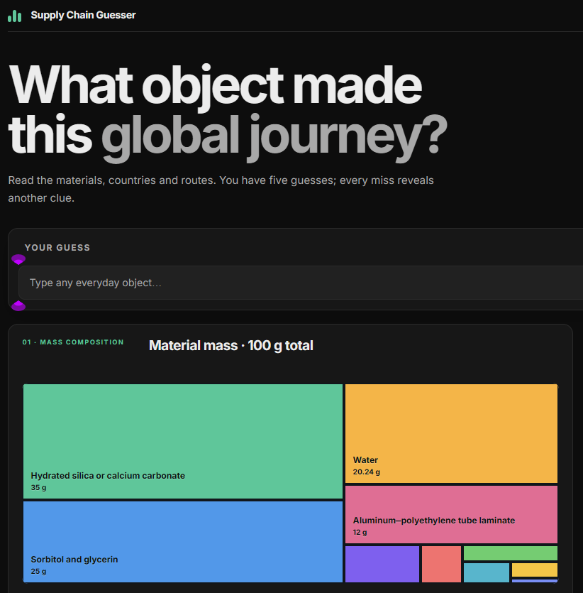
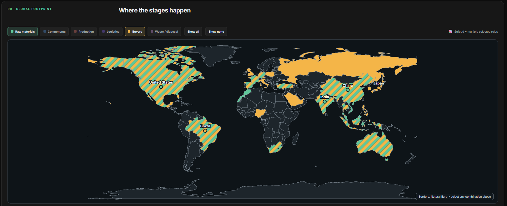

# Supply Chain Guesser

**Can you identify an everyday object from the global journey behind it?**

Supply Chain Guesser turns supply-chain evidence into a five-guess visual game. Each round starts with the object hidden and presents its material composition, estimated value, sourcing geography, production centers, logistics hubs, consumer markets, and likely end-of-life destinations. Every incorrect guess reveals a progressively clearer clue.

**[Play the public version](https://mobius-production-7e17.up.railway.app/supply-chain-guess)** — no Möbius account required.



## Explore a product's global footprint

The interactive map separates the main stages of a product's journey. Toggle raw materials, components, production, logistics, buyers, and waste independently; striped countries participate in more than one selected stage.



## How to play

1. Study the evidence without revealing the object.
2. Enter any everyday object as your guess.
3. Use the clue unlocked after each unsuccessful attempt.
4. Identify the object within five guesses—or see the correct answer after the fifth miss.
5. Read the finished product story to follow its journey from raw materials through manufacturing, trade, use, and end of life.

## What each round includes

- material mass and estimated commodity value;
- a typical finished-product price range;
- leading raw-material countries and their associated inputs;
- component and processing centers where relevant;
- production, logistics, buyer, and disposal geography;
- selectable world-map layers with multi-role highlighting;
- four fixed progressive clues;
- tolerant matching for common names, synonyms, and minor spelling errors;
- a concise post-answer manufacturing and global-journey explanation; and
- a reputable learning link or *How It's Made* video where available.

Signed-in Möbius players can optionally ask an AI reviewer to reconsider a rejected synonym or matching subtype. The player sees only the accept/reject verdict, never hidden comparison details. The public version uses the built-in matching and clue system without requiring an account.

## Data approach

The game combines product composition studies, commodity and trade statistics, industry references, and waste data into consistent round-level estimates. Country shares and material breakdowns are designed for comparison and learning—not as traceable supplier records for a particular brand or individual product.

Every evidence panel includes a data-limitations note. The map shows stage roles rather than literal shipping paths, and percentages can combine different public datasets and reference years.

## Run in Möbius

This repository is a Möbius mini-app. Its entry point is `index.jsx`, with the app contract in `mobius.json`. The app is intentionally online-only because optional signed-in feedback uses a Möbius-hosted reviewer.

To validate the source inside a Möbius instance:

```bash
python "$SCRIPTS_DIR/validate-app.py" /data/apps/supply-chain-guess
```

## Project status

Supply Chain Guesser is an evolving educational prototype. The current public build contains 30 objects and intentionally omits speculative shipping-route overlays while those routes require stronger product-specific evidence.
